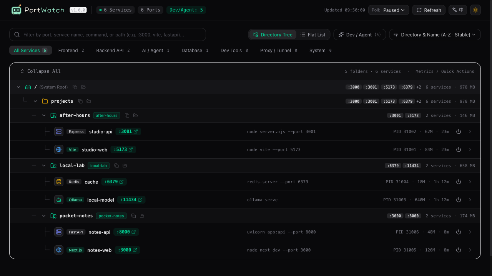
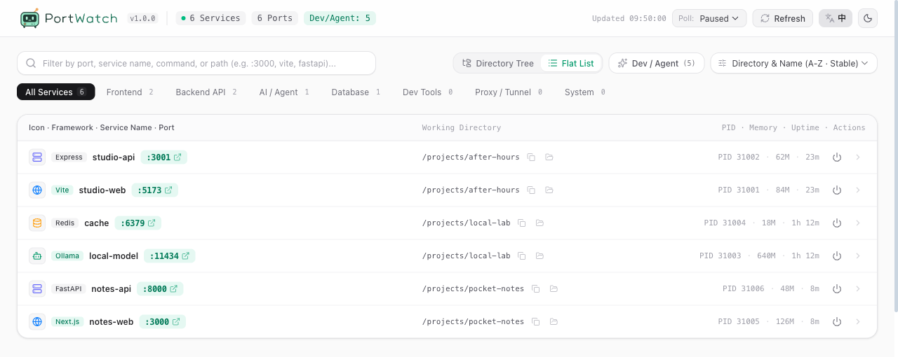
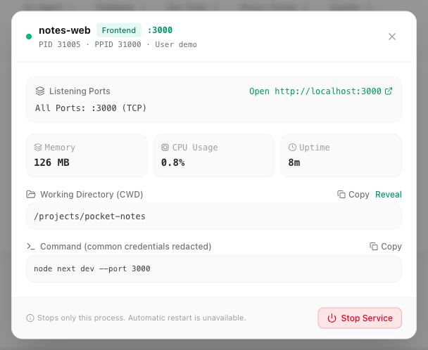

<div align="center">

<picture>
  <source media="(prefers-color-scheme: dark)" srcset="frontend/public/brand/logo-dark.svg">
  
</picture>

# Who’s using port 3000?

**And which port was that demo my agent built running on?**

Find what's using your port. Find your still-running demo.

[English](./README.md) · [简体中文](./README.zh-CN.md)

[](https://www.npmjs.com/package/@wiseqingyang/port-watch) [](./LICENSE)

[Get started](#get-started) · [Take a look](#a-little-order-for-your-open-projects) · [Share an idea](https://github.com/wiseqingyang/port-watch/issues)

</div>

PortWatch was made for these two small frustrations. It groups the services running on your machine by project: search `3000` to see what's using it, or find a familiar project folder and follow its port link to pick up where you left off.



<p align="center"><sub>Real UI, fictional demo projects. English / 中文. Light / dark.</sub></p>

## Get started

Run one command. Your browser opens the dashboard:

```sh
npx @wiseqingyang/port-watch@latest
```

You'll need **macOS or Linux** and [Node.js 22.12+](https://nodejs.org/). Windows isn't supported yet.

<details>
<summary>Keeping it around? Install the shortcut</summary>

```sh
npm install --global @wiseqingyang/port-watch
port-watch
```

</details>

<details>
<summary>Missing tools on Linux / trouble downloading?</summary>

Install the scanning tools on Debian / Ubuntu:

```sh
sudo apt install lsof procps
```

If your registry mirror hasn't picked up the latest release, use the official registry:

```sh
npx --registry=https://registry.npmjs.org @wiseqingyang/port-watch@latest
```

</details>

If `npx` reports `sh: port-watch: command not found` from inside this source checkout, include `@latest` as shown above. Without it, npm can select the local project instead of installing the published package, even when a registry is specified. To run your local source, use `pnpm build && pnpm start`.

## A little order for your open projects

- **🔎 What's using my port?** Type `3000` to see the service, its project directory, and the command that started it.
- **🗂️ Where did that demo go?** Search by project name or browse the folders. If it's still running, find its port and follow the link to open it again.
- **⏹️ Clean up when you're done.** Stop a selected process with confirmation. If it needs a force stop, you'll be asked separately.

## A different view. A different mood.

Prefer one tidy list? Switch to the flat view and sort by port, memory, or start time. Language and light/dark controls are always in the top-right corner.



## Take a look before you stop it

Open a service to check its directory, startup command, and resource usage. Make sure it's the one you meant, then stop it.

<p align="center">
  
</p>

## A few things to know

- Star services to save their project directories. Favorites remain accessible when scanning fails, with runtime status marked unknown. Upgrades without a favorites file work normally.
- Missing a service? Turn off the **Dev / Agent** filter to see all visible TCP listeners.
- Open the complete link printed in your terminal. After restarting PortWatch, use the new link. Keep that link and personal details in screenshots private.
- Stop affects only the selected process. Child processes or tools that restart services may keep running.
- Run locally as your regular user. No account to create. No telemetry.

---

<p align="center">
  
  <br>
  <b>For the projects you keep leaving open.</b>
  <br>
  A little tool with room for your ideas.
</p>

<p align="center">
  <a href="https://github.com/wiseqingyang/port-watch/issues">Ideas & bugs</a> ·
  <a href="./CONTRIBUTING.md">Make it yours</a> ·
  <a href="./LICENSE">MIT</a>
</p>
